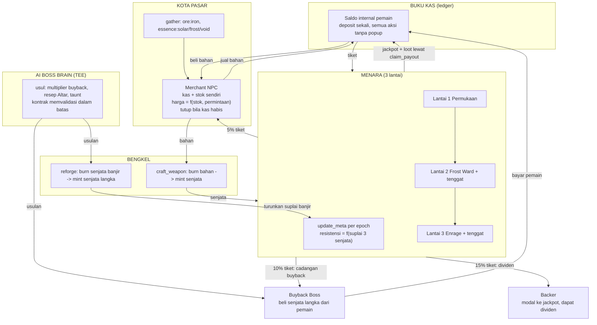

---
aliases:
  - "The Spire v3.1"
  - "BossVault Protocol v3.1"
  - "Ide 3 v3.1"
tags:
  - "idea"
  - "standalone"
  - "games-track"
  - "nfts-track"
  - "privacy-track"
status: "MASTER SPEC v3.1 — Skala penuh: 3 senjata (+Void), Backer, buyback, AI penuh, meta per epoch, stance + acak, Boss Tribute, dibangun berlapis dengan garis potong"
created: "2026-11-06"
updated: "2026-11-09"
working_name: "The Spire v3.1 — Menara Raid Berlantai + Kota Pasar NPC + Ekonomi Senjata yang Menyeimbangkan Diri + AI Boss Brain"
tracks:
  - "Games With Real Economies (utama)"
  - "Privacy & Private AI (AI Boss Brain di NEAR AI Cloud TEE)"
  - "NFTs That Do Something (roadmap: Trophy NFT)"
risk: "tinggi (ruang lingkup besar, waktu singkat)"
---

# The Spire v3.1 — Dokumen Spesifikasi Ekosistem Penuh

> **Posisi dokumen:** menggantikan v3. Menulis **apa yang akan dibangun**, **urutan pembangunannya**, **di mana garis potongnya**, dan **apa yang sudah ada**.
> **Pembagian kerja:** satu developer mengerjakan seluruh backend (kontrak, logika, relayer AI, tes). Mentor mengerjakan UI dan video demo. Karena itu kontrak harus punya **antarmuka yang stabil** (Bagian 11).
> **Cara membaca:** Bagian 0 (perubahan), Bagian 10 (urutan dan garis potong), Bagian 11 (serah-terima ke mentor).

---

## 0. Apa yang Berubah dari v3

| # | v3 | v3.1 | Alasan |
| --- | --- | --- | --- |
| 1 | 2 senjata (Solar, Frost) | **3 senjata (+Void)**, total resistensi 13500 bps | Skala penuh sesuai keputusan |
| 2 | Contoh renormalisasi `[8500, 3113, 1886]` | **Dikoreksi:** `[8500, 3114, 1886]` dan aturan sisa pembulatan ditulis eksplisit | Contoh lama berjumlah 13499 (salah 1) |
| 3 | Resistensi dihitung langsung dari suplai | **Disimpan, diperbarui per epoch** (`update_meta`), pergeseran dibatasi `MAX_SHIFT_BPS` | Menutup manipulasi suplai mendadak |
| 4 | 10% tiket ke Merchant | **Pembagian tiket penuh:** 70% jackpot / 15% Backer / 10% buyback / 5% Merchant | Backer dan buyback masuk |
| 5 | Buyback, Backer, AI penuh = roadmap | **Masuk jadwal** sebagai Lapis 6, 9, dan 7 | Keputusan skala penuh |
| 6 | AI hanya stretch (taunt) | **AI penuh:** multiplier buyback, resep Altar, taunt; kontrak memvalidasi | Track Privacy & Private AI |
| 7 | Stance + acak = stretch | **Lapis 8**: 3 giliran, 3 stance, faktor acak 90–110% | Kedalaman taktis |
| 8 | Jadwal berurutan datar | **Lapis dengan garis potong** + hitungan jam jujur | Ruang lingkup ±30 jam vs kapasitas ±16 jam |
| 9 | Status: v0.4 belum teruji penuh | **Tes 1–12 di testnet lolos semua** | Konfirmasi 9 Nov |

---

## 1. Masalah yang Dipecahkan

1. **Meta statis dan inflasi item.** Semua pemain memakai satu senjata terbaik; item lain jadi sampah; developer harus *nerf* manual.
2. **Boss/NPC tanpa neraca keuangan.** Monster hanya keran hadiah dari udara kosong.
3. **Popup wallet di setiap klik** merusak alur permainan.

**Jawaban The Spire:** Boss membaca suplai senjata dan menaikkan resistensi terhadap yang paling banyak beredar. Pemain **membakar** senjata berlebih (reforge) dan **menempa** yang langka. Pasar NPC punya kas dan stok sendiri. AI Boss Brain di dalam TEE mengusulkan harga buyback dan resep, tetapi **kontrak yang memutuskan**. Tidak ada patch developer.

**Analogi:** arcade bertingkat. Tiap lantai punya mesin hadiah dengan aturan sendiri. Uang disimpan di brankas pusat (kontrak induk), mesin hanya punya papan nama (sub-account). Di lantai dasar ada kios yang menukar bahan dengan uang.

---

## 2. Ekosistem



### 2.1 Aliran Uang

| Dari | Ke | Besar | Mekanisme |
| --- | --- | --- | --- |
| Pemain | Saldo internal | Deposit | `deposit()` (1 popup) |
| Saldo pemain | Jackpot lantai | 70% tiket | `attack` |
| Saldo pemain | Dividen Backer lantai | 15% tiket | `attack` (bila tidak ada Backer: masuk jackpot) |
| Saldo pemain | Cadangan buyback lantai | 10% tiket | `attack` |
| Saldo pemain | Kas Merchant | 5% tiket | `attack` |
| Backer | Jackpot lantai | Modal | `back_boss_vault` (payable) |
| Cadangan buyback | Pemain | Harga × multiplier | `sell_to_boss_buyback` |
| Merchant ↔ Pemain | | Harga dari stok dan permintaan | `sell_to_merchant`, `buy_from_merchant` |
| Jackpot lantai | Pemain | 10% last attack + 90% proporsional damage | `claim_payout` |
| Jackpot lantai N | Jackpot lantai N+1 | 10% | saat Boss N tumbang |
| Saldo internal | Wallet | Semua / sebagian | `withdraw` |

*Selama lapis 4–5 pembagian tiket sementara 90% jackpot / 10% Merchant, lalu 80/10/10 setelah buyback; angka disimpan sebagai konfigurasi (`SPLIT_BPS`), bukan di banyak tempat.*

### 2.2 Aliran Item

| Aksi | Efek pada suplai senjata |
| --- | --- |
| `claim_starter` | Naik: 4 Solar + 1 Frost per akun (terkunci) |
| `craft_weapon` | Naik (+1, bahan dibakar) |
| `reforge` | Turun (burn lebih banyak, mint lebih sedikit) |
| `sell_to_boss_buyback` | Turun (senjata dibakar) |
| Boss Tribute | Turun saat disita; naik lagi saat diklaim pemenang |

---

## 3. Peran

### 3.1 Tim

| Pihak | Tanggung jawab |
| --- | --- |
| **Developer (kamu)** | Seluruh kontrak, logika, tes, deploy, relayer AI, `verify.ts`, skrip regresi, `pricing.ts` + test vector, dokumen serah-terima |
| **Mentor** | UI satu halaman, login/Function Call Key di klien, video demo, review keamanan 30 menit |

### 3.2 Peran pemain

| Peran | Apa yang dilakukan | Motivasi |
| --- | --- | --- |
| **Raider** | Bayar tiket, serang Boss, naik lantai | Jackpot + loot |
| **Pengrajin** | Gather, craft, reforge senjata yang sedang langka, jual ke Merchant atau Boss | Profit dari kelangkaan |
| **Backer** | Setor modal ke jackpot lantai | Dividen dari tiket yang gagal (berisiko: modal ikut dibayarkan bila Boss tumbang) |
| **Investor Merchant** | Setor modal agar toko buka | Margin jual-beli |

---

## 4. Mekanik dan Rumus

### 4.1 Item dan Resep

| ID item | Jenis | Elemen |
| --- | --- | --- |
| `ore:iron` | bahan | — |
| `essence:solar` / `essence:frost` / `essence:void` | bahan | 0 / 1 / 2 |
| `weapon:solar` / `weapon:frost` / `weapon:void` | senjata | 0 / 1 / 2 |

- **Craft:** 2 `ore:iron` + 3 `essence:<elemen>` → 1 senjata elemen itu.
- **Reforge:** burn jumlah senjata elemen asal → mint senjata elemen tujuan. Resep default `reforge_2_to_1`. Resep `reforge_3_to_2` (burn 3, mint 2) dapat dibuka AI bila pangsa elemen asal ≥ 5000 bps.
- **Gather:** +2 unit item pilihan (deterministik), cooldown 30 detik, batas **20 unit/akun/epoch**.
- **Starter (sekali per akun):** 4 `weapon:solar`, 1 `weapon:frost`, 0 `weapon:void` + 4 `ore:iron`, 3 tiap `essence`. **Senjata starter terkunci** (*starter-locked*): tidak bisa dijual ke buyback dan tidak bisa disita Boss.
- Karena Void tidak ada di starter, **Void langka di awal dan menjadi titik lemah alami Boss**.

### 4.2 Resistensi Adaptif (3 elemen)

**Konstanta:** total `13500` bps, batas tiap elemen `[1000, 8500]`, pengali `1.35`.

```
share_i  = S_i * 10000 / max(sum(S), 1)
target_i = clamp(share_i * 135 / 100, 1000, 8500)
renormalisasi sampai sum == 13500 (maks 3 iterasi, lalu langkah akhir)
```

**Aturan renormalisasi (deterministik):**
1. `diff = 13500 - sum`.
2. Elemen **layak**: bila `diff > 0`, yang nilainya `< 8500`; bila `diff < 0`, yang nilainya `> 1000`. Elemen yang "dipaku" (pinned) oleh modifier tidak ikut.
3. Bagi `diff` rata ke elemen layak (pembagian bulat ke arah nol). **Sisa pembulatan diberikan +1 (atau −1) ke elemen layak berurutan dari indeks terkecil** sampai habis.
4. Clamp ulang ke `[1000, 8500]`, ulangi paling banyak 3 kali.
5. **Langkah akhir:** bila masih belum tepat 13500, sisa ditambahkan/dikurangkan ke elemen yang punya ruang terbanyak (indeks terkecil bila seri). Dengan 3 elemen dan rentang 3000–25500, 13500 selalu dapat dicapai.

**Contoh terverifikasi (test vector):**

| Suplai (Solar/Frost/Void) | Setelah clamp | Hasil akhir | Jumlah |
| --- | --- | --- | :---: |
| 0 / 0 / 0 | 1000 / 1000 / 1000 | **4500 / 4500 / 4500** | 13500 |
| 80 / 20 / 10 | 8500 / 2454 / 1227 | **8500 / 3114 / 1886** | 13500 |
| 8 / 2 / 0 (starter 2 akun) | 8500 / 2700 / 1000 | **8500 / 3350 / 1650** | 13500 |
| 100 / 0 / 0 | 8500 / 1000 / 1000 | **8500 / 2500 / 2500** | 13500 |

**Jaminan:** karena jumlah selalu 13500 untuk 3 elemen, **minimal satu elemen ≤ 4500 bps**. Selalu ada titik lemah.

### 4.3 Meta per Epoch (`update_meta`)

- Resistensi dasar disimpan di state (`meta_resistance`), awalnya `[4500, 4500, 4500]`.
- Pada epoch baru, hitung vektor target `T` dari suplai (Bagian 4.2). Geser vektor sekarang `C` menuju `T` dengan faktor `α` sehingga **pergeseran terbesar ≤ `MAX_SHIFT_BPS` (2500)**: `C' = C + α (T − C)`. Karena jumlah `T` dan `C` sama (13500), jumlah `C'` tetap 13500; sisa pembulatan dibereskan oleh langkah renormalisasi yang sama.
- **Lazy:** `attack` memanggil pembaruan meta bila epoch sudah berganti. `update_meta()` publik tersedia untuk UI/relayer; panggilan di epoch yang sama ditolak (`E_SAME_EPOCH`).
- **Sebelum Lapis 5**, resistensi dihitung langsung dari suplai (tanpa epoch). Bentuk data yang dikembalikan `get_meta` sama; `next_epoch_in_ns` bernilai `null` sampai Lapis 5.

**Bias lantai (modifier):** dihitung saat dibaca, di atas resistensi dasar. Elemen target bias dipaku, nilainya naik sesuai bias (dibatasi 8500), lalu elemen lain dinormalisasi ulang dengan aturan 4.2. Jumlah tetap 13500.

### 4.4 Serangan (3 giliran, Lapis 8)

```
damage_giliran = KEKUATAN * (10000 - res_efektif) / 10000 * stance_bps / 10000 * acak_bps / 10000
damage_tercatat = min(damage_giliran, HP_sebelum_giliran)          (overkill tidak dihitung)
```
- `KEKUATAN` per giliran (usulan) **140** untuk ketiga senjata (3 giliran ≈ 420 dasar). HP lantai dikalibrasi ulang saat Lapis 8.
- **Stance (usulan):**

| Stance | Efek |
| --- | --- |
| Aggressive | × 12000 bps |
| Feint | × 10000 bps, rentang acak dipersempit ke [10000, 11000] (lebih bisa diandalkan) |
| Pierce | resistensi efektif dikurangi 1500 bps (min 0), × 9500 bps |

- **Acak:** `acak_bps ∈ [9000, 11000]` dari `env::random_seed()` yang dicampur dengan nomor giliran. **Batasan yang diketahui:** validator dapat memprediksi nilai ini; kerentanannya diredam oleh tiket di muka dan rentang sempit (±10%).
- **Sebelum Lapis 8:** satu serangan = satu pukulan, `damage = 400 * (10000 - res) / 10000`, tanpa stance dan acak. Tanda tangan fungsi sudah menerima `stances: Option<[u8;3]>` (diabaikan) agar ABI tetap.
- **Tiket dibayar di muka**, menang atau kalah.

### 4.5 Lantai (tabel konfigurasi)

| Lantai | HP | Tiket | Modifier | Tenggat putaran |
| --- | :---: | :---: | --- | --- |
| **1 Permukaan** | 1000 | 0.10 NEAR | Tidak ada | Tidak ada |
| **2** | 1600 | 0.15 NEAR | **Frost Ward:** bias +1500 bps pada Frost | 30 menit |
| **3** | 2500 | 0.25 NEAR | **Enrage:** HP pulih 10% tiap 5 menit tanpa serangan | 20 menit |

*Angka berlabel usulan. `set_floor_timing` (owner) memperpendek tenggat untuk demo.*

**Aturan naik lantai:** Boss N tumbang → lantai N+1 **terbuka dan tetap terbuka**. 10% jackpot menetes ke lantai N+1. Tiap lantai punya putaran sendiri yang berjalan independen.

### 4.6 Tenggat dan Enrage (diselesaikan *lazy*)

1. Tenggat putaran dimulai saat **serangan pertama** putaran itu: `deadline = waktu_serangan_pertama + durasi`.
2. Di awal tiap `attack`: bila `sekarang > deadline` dan Boss belum tumbang, putaran **kedaluwarsa**; jackpot, loot, dan modal Backer **dibawa ke putaran berikutnya**; damage lama dibuang; putaran baru dimulai.
3. `resolve_expired(floor)` dapat dipanggil siapa saja.
4. **Enrage (lantai 3):** di awal `attack`, `pulih = floor((sekarang - serangan_terakhir) / 5 menit) * 10% * max_hp`, dibatasi sampai `max_hp`. Penyembuhan tidak dihitung sebagai damage.
5. `get_floor` mengembalikan `deadline_ns`, `expired`, `time_left_ns` untuk hitung mundur UI.

### 4.7 Jackpot, Loot, dan Klaim (tanpa loop)

Saat Boss tumbang, kontrak **hanya menyimpan satu kuitansi** (`RoundResult`) lalu memulai putaran baru:
```
last_bonus   = jackpot * 10%
proporsional = jackpot - last_bonus
payout(akun) = proporsional * damage_akun / total_damage  (+ last_bonus bila penyerang terakhir)
```
Pembulatan ke bawah; sisa (*dust*) dibiarkan. Tiap pemain memanggil `claim_payout(floor, round)`; kontrak menandai "sudah diklaim" **sebelum** menambah saldo.

### 4.8 Merchant (aturan deterministik, tanpa AI)

```
tekanan_stok  = (stok_target - stok) / stok_target            (dibatasi -100%..+100%)
tekanan_minta = rata2_pembelian_5_epoch / stok_target
mid = harga_dasar * (1 + k1 * tekanan_stok + k2 * tekanan_minta)
mid = clamp(mid, harga_dasar * 0.5, harga_dasar * 2.0)
harga_jual_ke_pemain   = mid * (1 + spread)
harga_beli_dari_pemain = mid * (1 - spread)
toko tutup bila kas < kas_minimum
```

| Item | Harga dasar (usulan) | Stok target | k1 | k2 | Spread |
| --- | :---: | :---: | :---: | :---: | :---: |
| `ore:iron` | 0.02 NEAR | 100 | 0.5 | 0.3 | 10% |
| `essence:solar` / `frost` / `void` | 0.03 NEAR | 100 | 0.5 | 0.3 | 10% |

**Pengaman anti-kuras:** batas gather per akun per epoch, **batas pembelian Merchant per item per epoch** (usulan 40 unit), spread, harga turun saat stok menumpuk.

**Tooltip alasan (`reason` di `get_quote`):** *"Harga Iron Ore naik 18% karena stok tinggal 20% dari target dan 3 pembelian besar dalam 5 epoch terakhir."* Toko tutup: *"Toko tutup: kas 0.4 NEAR di bawah minimum 1.0 NEAR. Setor modal untuk membuka kembali."*

### 4.9 Buyback Boss (Lapis 6)

`sell_to_boss_buyback(floor, element, qty)`:
```
harga_satuan = BUYBACK_BASE * multiplier_bps[element] / 10000        (BUYBACK_BASE usulan 0.10 NEAR)
```
- `multiplier_bps` default 10000; AI boleh mengubah dalam [10000, 40000] (Bagian 4.11).
- Hanya senjata **tidak terkunci** (`sellable`). Senjata dibakar (suplai turun).
- Dibayar dari `buyback_reserve` lantai itu; **ditolak bila reserve tidak cukup**.
- **Batas volume per epoch** per lantai (usulan 5 unit) dan per akun (usulan 2).
- **Risiko arbitrase:** biaya craft ≈ 0.13 NEAR; multiplier tinggi dapat membuat craft-lalu-jual menguntungkan. Pengamannya: batas volume + saldo reserve terbatas + batas atas multiplier + `max_shift_bps` per epoch.

### 4.10 Backer (Lapis 9)

- `back_boss_vault(floor)` (payable): modal **masuk ke jackpot** lantai itu dan Backer mendapat *share* sebanding modal.
- **15% tiket** menjadi dividen Backer, dicatat dengan pola akumulator (`acc_dividend_per_share`), jadi O(1) tanpa loop. Bila tidak ada Backer, 15% itu masuk jackpot.
- `claim_backer_dividend(floor, cycle)` memakai pola *pull*.
- **Siklus Backer** (`cycle`) bertambah **hanya saat Boss tumbang**, tidak saat kedaluwarsa. Saat Boss tumbang, jackpot **termasuk modal Backer** dibayarkan ke Raider; share siklus itu berakhir. Dividen yang sudah terkumpul tetap bisa diklaim.
- Ini taruhan berisiko tinggi dengan imbalan dividen. **Dokumentasikan agar jelas di UI.**
- **Kehati-hatian teknis:** gunakan satuan share kecil (mis. 0.01 NEAR) dan `checked_mul`; uji dengan nilai ekstrem agar perkalian u128 tidak meluap.

### 4.11 AI Boss Brain (Lapis 7)

**Prinsip:** AI mengusulkan, kontrak memutuskan. AI tidak dipakai untuk resistensi atau harga Merchant (keduanya rumus deterministik).

**Peran AI (hal yang tidak bisa dihitung rumus):**
1. **Multiplier buyback** per senjata.
2. **Resep Altar** yang dibuka (dari daftar putih: `reforge_2_to_1`, `reforge_3_to_2`).
3. **Taunt/narasi** per lantai berdasarkan perilaku pemain.

**Bentuk usulan:**
```json
{
  "floor": 1,
  "buyback_multiplier_bps": [10000, 15000, 30000],
  "altar_recipe_id": "reforge_3_to_2",
  "taunt": "Pedang apimu hanya membuatku hangat."
}
```

**Validasi di kontrak:**

| Aturan | Nilai |
| --- | --- |
| Pemanggil | hanya `relayer_account_id` |
| Panjang array | 3 |
| Rentang tiap multiplier | `10000 ≤ x ≤ 40000` |
| Pergeseran per epoch | `|baru − lama| ≤ MAX_SHIFT_BPS` |
| Resep | ada di daftar putih |
| Panjang `taunt` | ≤ 200 karakter |
| Frekuensi | sekali per epoch per lantai |
| Tanda tangan | `signature` dan `chat_id` disimpan; diverifikasi terhadap **public key signer yang di-pin** |

**Relayer (TypeScript, off-chain):**
1. Baca `get_meta`, `get_floor`, `get_supply`, ringkasan event dari RPC.
2. Panggil NEAR AI Cloud, minta **hanya** JSON bentuk di atas.
3. Ambil `GET /v1/signature/{chat_id}`.
4. Panggil `apply_ai_proposal`. Bila ditolak, **jangan retry dengan nilai yang sama**; catat penolakan sebagai bukti batas bekerja.
5. Mode `--dry-run` mencetak usulan dan tanda tangan tanpa mengirim transaksi.
6. Kunci dan API key lewat `.env`, **tidak pernah di-commit**.

**Kejujuran klaim:** verifikasi atestasi TEE penuh di kontrak tidak dibangun. Yang dibuktikan on-chain adalah: akun relayer yang berwenang, usulan yang lolos validasi, dan jejak `chat_id` + `signature`. `scripts/verify.ts` menampilkan bukti tanda tangan dari API. **Cek dokumentasi NEAR AI Cloud** untuk algoritma tanda tangan dan pesan yang ditandatangani sebelum menulis "terverifikasi on-chain" di pitch. NEAR menyediakan fungsi bawaan verifikasi tanda tangan di kontrak, tetapi pemakaiannya bergantung pada jawaban itu.

### 4.12 Boss Tribute (Lapis 10)

Jika `res_efektif(elemen) ≥ REPEL_BPS` (usulan **7000**) saat `attack`, serangan **ditolak**: 1 senjata elemen itu pindah dari pemain ke **loot lantai**. Tiket tetap dipotong; damage dihitung seperti biasa.

**Pagar pengaman:**
1. **Senjata starter dan senjata terakhir yang dimiliki tidak pernah disita.**
2. Maksimal 1 senjata per serangan; batas total loot per putaran (usulan 20 per elemen).
3. Senjata disita **keluar dari suplai** dan dicetak kembali saat diklaim pemenang.
4. Loot dibagi saat Boss tumbang lewat `claim_payout`: `loot * 90%` proporsional damage, `loot * 10%` untuk penyerang terakhir. Pembulatan ke bawah, dust dibakar.
5. Putaran kedaluwarsa: loot dibawa ke putaran berikutnya.

**Batasan yang diterima:** deterministik, jadi pemain yang membaca Meta Radar tidak kehilangan senjata. Yang kena hanya pemain naif.

---

## 5. Game Loop

### 5.1 Loop 30 detik
Login → deposit sekali → klaim starter → **Gather** → lihat harga Merchant + alasannya → jual satu bahan.

### 5.2 Loop 5 menit
Gather → jual sebagian → **Craft** → cek **Meta Radar** (suplai dan resistensi 3 elemen; Void biasanya titik lemah) → reforge senjata banjir → raid Lantai 1 → lihat jackpot, log damage, klaim.

### 5.3 Loop per sesi
Naik ke lantai 2 dan 3 (modifier dan tenggat berbeda), menjual senjata langka ke buyback Boss, menjadi Backer atau Investor Merchant, membaca taunt AI dan melihat harga buyback bergeser tiap epoch.

---

## 6. Arsitektur Teknis

```
Browser (UI mentor) --RPC--> Kontrak Induk (NEAR testnet) --> NearBlocks
                                  ^
        Relayer (TypeScript) -----+--> NEAR AI Cloud TEE
```

### 6.1 Keputusan arsitektur
1. **Dana di kontrak induk**; sub-account Boss dan Merchant hanya identitas.
2. **Saldo internal:** `deposit()` sekali (popup), lalu semua aksi tanpa popup.
3. **Function Call Key** hanya untuk fungsi non-payable.
4. **Kontrak membaca suplai sendiri.**
5. **State diubah dulu, transfer kemudian** (pola *pull* lewat `withdraw`, dengan callback pengembalian saldo bila transfer gagal).
6. **Tidak ada cron:** tenggat, Enrage, dan epoch diselesaikan *lazy*.
7. **Konfigurasi di satu tempat** (`constants.rs`): `SPLIT_BPS`, lantai, harga, batas.

### 6.2 Fungsi (rencana akhir)

| Fungsi | Jenis | Signless? | Lapis |
| --- | --- | :---: | :---: |
| `deposit()` | call, payable | Tidak | 1 |
| `withdraw()` | call | Ya | 1 (callback) |
| `fund_jackpot(floor)` | call, payable | Tidak | 2 |
| `claim_starter()` | call | Ya | 1 |
| `gather(item_id)` | call | Ya | 3 |
| `craft_weapon(element)` | call | Ya | 3 |
| `reforge(burn_element, target_element)` | call | Ya | 3 |
| `attack(floor, weapon, stances?)` | call | Ya | 2 (stance aktif di 8) |
| `claim_payout(floor, round)` | call | Ya | 2 |
| `resolve_expired(floor)` | call | Ya | 2 |
| `sell_to_merchant`, `buy_from_merchant` | call | Ya | 4 |
| `fund_merchant()`, `invest_merchant()` | call, payable | Tidak | 4 |
| `update_meta()` | call | Ya | 5 |
| `sell_to_boss_buyback(floor, element, qty)` | call | Ya | 6 |
| `apply_ai_proposal(floor, proposal, chat_id, signature)` | call | Relayer | 7 |
| `set_relayer`, `set_tee_signer_pubkey` | call | Owner | 7 |
| `back_boss_vault(floor)` | call, payable | Tidak | 9 |
| `claim_backer_dividend(floor, cycle)` | call | Ya | 9 |
| `set_floor_timing`, `seed_merchant` | call | Owner | 2, 4 |

### 6.3 View

`get_floor(floor)`, `get_tower()`, `get_meta(floor)` (suplai, resistensi 3 elemen, titik lemah, `shifted_by`, `next_epoch_in_ns`), `get_balance`, `get_inventory`, `get_supply`, `get_claimable(account, floor, round)`, `get_merchant()`, `get_quote(item, side, qty)` (dengan `reason`), `get_buyback_quote(floor, element)`, `get_ai_state(floor)` (usulan terakhir, `chat_id`, `signature`, epoch), `get_backer(floor, account)`, `mt_balance_of`, `mt_total_supply`.

### 6.4 Function Call Key (allowlist)

`claim_starter`, `gather`, `craft_weapon`, `reforge`, `attack`, `claim_payout`, `resolve_expired`, `update_meta`, `sell_to_merchant`, `buy_from_merchant`, `sell_to_boss_buyback`, `claim_backer_dividend`, `withdraw`.
Popup tetap muncul untuk: `deposit`, `fund_jackpot`, `fund_merchant`, `invest_merchant`, `back_boss_vault`.

### 6.5 Event

Format `EVENT_JSON:{"standard":"spire","version":"1.0.0","event":"...","data":{...}}`.
`deposit`, `withdraw`, `starter_claimed`, `gather`, `craft`, `reforge`, `raid`, `boss_defeated`, `round_expired`, `floor_unlocked`, `payout_claimed`, `meta_updated`, `merchant_trade`, `merchant_closed`, `merchant_opened`, `buyback`, `backer_staked`, `dividend_claimed`, `ai_proposal_applied`, `ai_proposal_rejected`, `tribute_seized`.

### 6.6 Kode error

`E_INSUFFICIENT_BALANCE`, `E_INSUFFICIENT_ITEM`, `E_ALREADY_CLAIMED`, `E_COOLDOWN`, `E_EPOCH_CAP`, `E_SHOP_CLOSED`, `E_OUT_OF_STOCK`, `E_FLOOR_LOCKED`, `E_PAYOUT_CLAIMED`, `E_NOTHING_TO_CLAIM`, `E_SAME_EPOCH`, `E_RESERVE_LOW`, `E_VOLUME_CAP`, `E_INVALID_PROPOSAL`, `E_UNAUTHORIZED`, `E_INVALID_ARGS`. Pesan lama berbahasa Indonesia ("Starter sudah diklaim", "Klaim starter dulu", dst.) diseragamkan ke kode di versi berikutnya; **kabari mentor saat itu terjadi**.

---

## 7. Invarian yang Dijaga (bahan tes dan halaman "Bukti")

1. **Neraca uang:** NEAR di kontrak = saldo internal semua akun + jackpot semua lantai + dividen Backer belum diklaim + cadangan buyback semua lantai + kas Merchant + hadiah belum diklaim + dust. Tidak ada uang keluar tanpa hak.
2. **Resistensi:** jumlah selalu **13500 bps**, tiap elemen dalam [1000, 8500], minimal satu elemen ≤ 4500.
3. **Meta:** pergeseran per epoch ≤ `MAX_SHIFT_BPS`.
4. **Klaim:** satu akun satu klaim per `(floor, round)`; total klaim ≤ pool.
5. **Suplai:** suplai senjata = jumlah saldo senjata pemain (+ loot tertahan, dihitung terpisah).
6. **Starter-locked:** tidak pernah dijual ke buyback atau disita.
7. **Overkill:** damage tercatat ≤ HP sebelum serangan.
8. **Isolasi putaran:** damage dan klaim satu putaran tidak bocor ke putaran lain.
9. **Lazy time:** `attack` setelah tenggat selalu menutup putaran lama lebih dulu.
10. **Buyback:** pembayaran ≤ cadangan; tidak melebihi batas volume.
11. **Backer:** dividen yang diklaim ≤ dividen yang terkumpul; modal tidak dikembalikan setelah Boss tumbang.
12. **AI:** usulan di luar batas selalu ditolak; relayer selain akun yang ditetapkan selalu ditolak.

---

## 8. Strategi Tes

| Lapis tes | Alat | Isi |
| --- | --- | --- |
| **Unit** | `cargo test` | Fungsi murni: `compute_resistances` (≥ 10 kasus, termasuk tabel 4.2), `compute_payout`, `compute_price`, validasi usulan AI. Dibaca dari test vector JSON. |
| **Integrasi** | `near-workspaces` (opencode menulis, kamu menjalankan) | Alur Alice + Bob, tenggat (waktu dimajukan), Enrage, epoch, buyback, Backer, penolakan AI. |
| **Testnet** | `spire-test.sh` | Regresi + tes baru per lapis. **Bukti transaksi untuk demo.** |

**Aturan regresi:** setiap perubahan struct → kontrak baru → skrip regresi berjalan. Catatan: angka lama (resistensi `[7200, 1800]`, klaim 1.204416 / 0.155584 NEAR) **berubah** dengan 3 senjata dan pembagian tiket baru; harapannya dihitung ulang per lapis dan disimpan sebagai test vector, bukan dikira-kira. Untuk menjaga kesinambungan, **mode 2 senjata dipertahankan sebagai konfigurasi** (`ACTIVE_ELEMENTS`) selama lapis 2, sehingga 12 tes lama tetap menjadi jaring pengaman refactor.

---

## 9. Matriks Risiko

| Risiko | Dampak | Mitigasi |
| --- | --- | --- |
| Ruang lingkup ±30 jam vs kapasitas ±16 jam | Fitur setengah jadi | Lapis dengan garis potong (Bagian 10) |
| Redeploy menghancurkan state | UI mentor rusak | Akun kontrak baru per lapis; kabari mentor |
| ABI berubah saat UI dibangun | Kerja ulang | Semua array panjang 3 dan parameter `floor` sejak sekarang; hanya menambah fungsi |
| Bug renormalisasi 3 elemen | Resistensi salah | Test vector ≥ 10 kasus, sudah ada 4 terverifikasi |
| Sybil: banyak akun gather lalu jual | Kas Merchant terkuras | Batas gather, batas beli per epoch, harga turun saat stok menumpuk |
| Arbitrase buyback (craft lalu jual) | Cadangan terkuras | Batas volume, batas multiplier, `max_shift_bps`, saldo reserve |
| Backer/dividen menambah celah neraca | Uang hilang atau tersangkut | Invarian neraca wajib lolos sebelum merge; uji nilai ekstrem |
| AI mengusulkan nilai ekstrem | Ekonomi rusak | Validasi di kontrak; penolakan dicatat |
| Tanda tangan TEE tidak diverifikasi penuh | Klaim terlalu kuat | Tulis batasan; bukti ditampilkan lewat `verify.ts` |
| `random_seed` dapat diprediksi validator | Bias hasil | Rentang ±10%, tiket di muka; tulis sebagai batasan |
| `withdraw` gagal setelah saldo dinolkan | Dana hilang | Callback pengembalian saldo (Lapis 1) |
| Storage ditanggung kontrak | Saldo kontrak terkuras akun spam | Catatan untuk mentor; aman untuk testnet |
| Kelelahan | Kualitas turun | Daftar "yang sengaja tidak dibangun" di README sejak awal |

---

## 10. Urutan Pembangunan Berlapis dan Garis Potong

**Aturan:** satu lapis = kontrak baru + skrip regresi hijau + serah-terima ke mentor. Jangan menumpuk dua lapis tanpa tes.

| Lapis | Isi | Jam | Kumulatif | Handoff ke mentor |
| :---: | --- | :---: | :---: | --- |
| 1 | Hardening: callback `withdraw`, `owner` + `#[init]`, event log | 1,5 | 1,5 | `deposit`, `claim_starter`, `attack`, `claim_payout`, `withdraw` + event |
| 2 | Item generik + **Void** + lantai berbasis konfigurasi + renormalisasi 3 elemen + `resolve_expired` | 5 | 6,5 | **ABI inti dibekukan (target: 10 Nov siang)** |
| 3 | `gather`, `craft_weapon`, `reforge` | 2 | 8,5 | Loop inti + contoh JSON |
| 4 | **Merchant:** harga, tutup/buka, `get_quote`, `fund_merchant` | 4 | 12,5 | ABI Merchant + `pricing.ts` |
| **GARIS POTONG 1: akhir 11 Nov. Lapis 1–4 wajib selesai.** | | | | |
| 5 | `update_meta` per epoch | 2 | 14,5 | Field epoch di `get_meta` |
| 6 | Buyback Boss | 2 | 16,5 | `get_buyback_quote` |
| 7 | **AI penuh:** `apply_ai_proposal`, relayer, `verify.ts` | 6 | 22,5 | `get_ai_state`, daftar event AI |
| **GARIS POTONG 2: 12 Nov siang. Lapis 5–7 selesai atau ditunda.** | | | | |
| 8 | Stance + acak + modifier lantai 2 dan 3 final + kalibrasi HP | 2 | 24,5 | Parameter `stances` aktif |
| 9 | Backer + dividen | 3 | 27,5 | `get_backer` |
| 10 | Boss Tribute | 2 | 29,5 | Event `tribute_seized` |

**Hitungan jujur:** total ±30 jam. Kapasitas ±16 jam (4 hari × 4 jam). Dengan ±7 jam/hari, Lapis 1–7 hampir pasti selesai. Dengan ±4 jam/hari, realistisnya Lapis 1–5 dan sebagian 6–7; **AI penuh** menjadi **AI taunt + bukti tanda tangan**.

**Aturan tegas:**
1. Tertinggal > 2 jam → pindah ke lapis berikutnya yang lebih rendah, jangan memperpanjang.
2. Backer dan Tribute tidak dikerjakan sebelum Lapis 7 hijau.
3. **12 Nov: freeze.** Hanya perbaikan bug dan dokumentasi. **13 Nov:** buffer submit. **Cek ulang deadline resmi** (spec awal menyebut 12 Nov).

### 10.1 Status per 9 Nov

| Komponen | Status |
| --- | --- |
| Kontrak v0.4: `ledger.rs`, putaran, `claim_payout`, unit test payout | Selesai |
| **Tes testnet 1–12** (state awal, starter, penolakan, pendanaan, Boss tumbang, klaim, tarik, neraca uang, reforge, isolasi putaran) | **Lolos semua** |
| Skrip regresi `spire-test.sh` | Ada; dipakai ulang sebagai jaring pengaman |
| Akun | `spire.testnet`; kontrak uji `v1.spire.testnet` (sesuaikan dengan yang dipakai) |
| Lapis 1–10 | Belum dimulai |

---

## 11. Serah-Terima ke Mentor (UI dan Video)

**Yang diserahkan developer:**
1. **ID kontrak** tetap dan daftar fungsi/view (Bagian 6) dengan contoh JSON per fungsi (`INTERFACE.md` diperbarui jadi dokumen *as-built* per lapis).
2. **Allowlist Function Call Key** (6.4) dan daftar kode error + terjemahan pesan.
3. **Daftar event** untuk panel feed.
4. **`pricing.ts` + test vector** agar fast-forward di UI memakai rumus yang sama; tampilan fast-forward wajib berlabel **SIMULASI**.
5. **Skrip demo teknis:** urutan transaksi yang menghasilkan momen terbaik (Meta Radar → Reforge → Raid → Boss tumbang → klaim → buyback → taunt AI) beserta angka yang diharapkan.

**Hal penting untuk bentuk data (berlaku sejak sekarang):**
- **Semua array panjang 3** (`supply`, `resistance`, `buyback_multiplier`), urutan `[solar, frost, void]`.
- **Semua fungsi lantai menerima parameter `floor`**.
- Nilai uang selalu string yocto; HP dan damage bilangan bulat.
- Sebelum Lapis 5, `get_meta.next_epoch_in_ns` bernilai `null`.

**Yang diminta dari mentor:**
1. Tanggal pembekuan ABI loop inti (usulan: **10 Nov siang**).
2. Login email/sosial dan Function Call Key di klien.
3. Tampilan lantai (daftar, hitung mundur, modifier), Meta Radar 3 elemen, panel Merchant, panel buyback, panel Backer, panel AI (taunt + bukti).
4. **Review keamanan 30 menit** (`withdraw` dan callback, storage, randomness, validasi AI).

---

## 12. Skrip Demo 90 Detik

| Waktu | Isi |
| --- | --- |
| 0–10 s | Masalah: semua pemain memakai satu senjata, ekonomi mati |
| 10–25 s | Instant Play tanpa popup, gather dan jual ke Merchant (tooltip harga) |
| 25–45 s | Meta Radar: Solar dominan, Boss kebal Solar; Void langka = titik lemah; AI menaikkan harga buyback Void |
| 45–60 s | Reforge: burn Solar → mint Void, suplai turun, resistensi bergeser di epoch berikutnya |
| 60–80 s | Raid → Boss tumbang → klaim jackpot → tautan NearBlocks → bukti tanda tangan TEE |
| 80–90 s | "Satu menara, tiap lantai ekonomi sendiri, AI mengusulkan, kontrak memutuskan." |

Cadangan 10 detik: fast-forward Kota Pasar.

---

## 13. Daftar "Yang Sengaja Tidak Dibangun" (untuk README)

- Verifikasi atestasi TEE penuh di kontrak.
- Trophy NFT dinamis (NEP-171 + NEP-177).
- Party raid dan guild.
- Lantai 4 ke atas (arsitektur sudah berbasis tabel).
- `mt_transfer` antar pemain (token terikat pemain di versi ini).
- Perlindungan penuh terhadap Sybil.

---

## 14. Glosarium

| Istilah | Arti singkat |
| --- | --- |
| Lazy | Dihitung saat ada yang menyentuhnya, bukan berjalan sendiri |
| Round (putaran) | Satu siklus hidup Boss di satu lantai |
| Cycle (siklus Backer) | Berganti hanya saat Boss tumbang |
| Epoch | Satu siklus evaluasi (resistensi dan harga AI diperbarui per epoch) |
| Modifier | Aturan khusus lantai (Frost Ward, Enrage) |
| Starter-locked | Item awal yang tidak bisa dijual atau disita |
| Dust | Sisa pembulatan yang tidak dibagikan |
| bps | Basis points: 100 bps = 1% |
| Function Call Key | Kunci terbatas di browser untuk fungsi tertentu tanpa popup |
| TEE | Ruang komputasi tertutup yang bisa membuktikan hasilnya tidak diutak-atik |

---

**Sumber:** v1 (`Ide 3 — BossVault Protocol`), v2 (`The Spire`), v3 (solo + mentor UI), dan keputusan 9 Nov 2026: skala penuh dengan Void, Backer, buyback, AI penuh, dibangun berlapis dengan garis potong; tes testnet 1–12 lolos.
