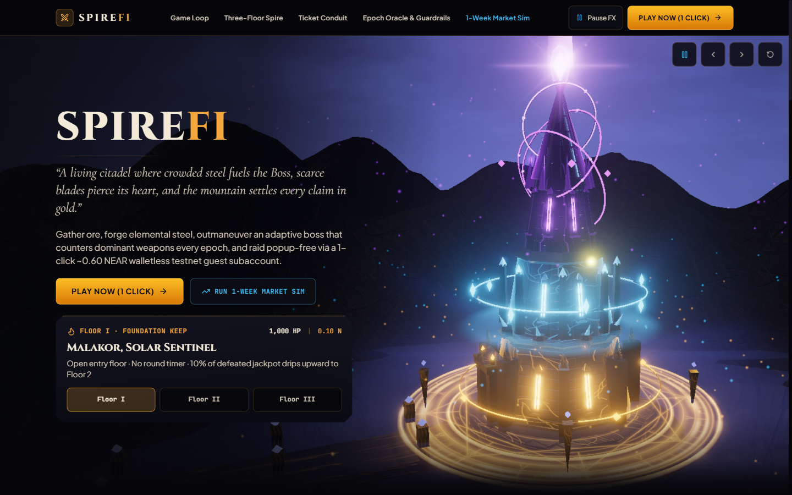
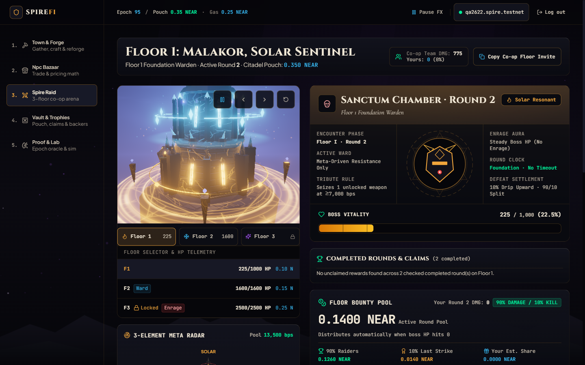
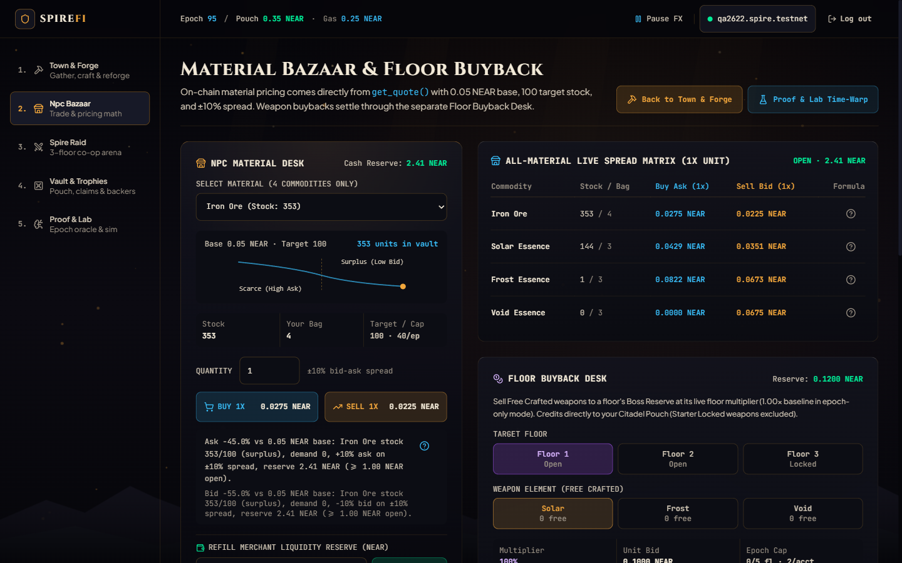
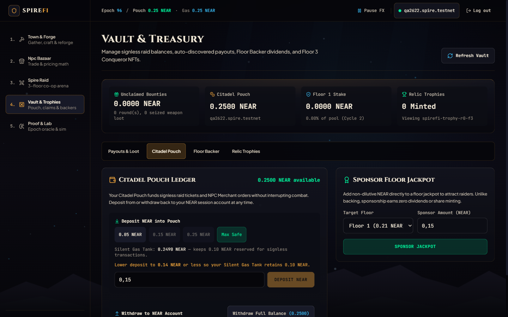
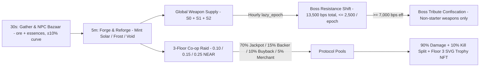
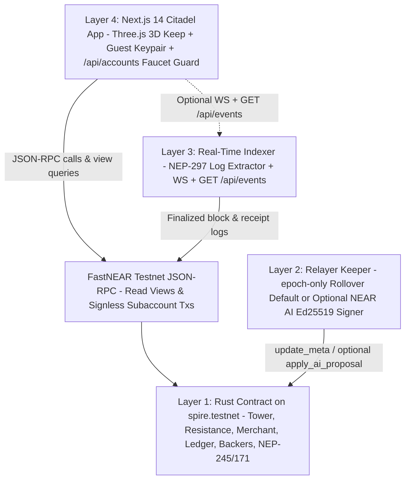

<div align="center">

# SpireFi Protocol

**Autonomous On-Chain Boss Battler, Supply-Driven Adaptive Resistance Market & Deterministic GameFi Engine on NEAR Protocol**

[](https://testnet.nearblocks.io/address/spire.testnet)
[](https://github.com/nearai/near-hackathon-prompt-examples/blob/main/tracks/09-games.md)
[](#9-hackathon-provenance-stack-and-license)
[](LICENSE)

[**5-Minute Quickstart**](#3-5-minute-judge-quickstart) · [**Visual Tour**](#2-citadel-visual-tour) · [**Do X → See Y Walkthrough**](#5-judge-verification-walkthrough) · [**Architecture**](#4-game-loop-and-system-architecture) · [**Honest Disclosures**](#6-honest-scope-disclosures) · [**Math & ABI**](#7-technical-specification)

</div>

---

## 1. Problem, Solution, and Why NEAR

> Built for NEAR Hackathon Track **`games`** (*"The economy is the gameplay"*): self-balancing on-chain markets, player-driven adaptation without developer patches, and popup-free testnet UX.

| Problem in On-Chain Games | How SpireFi Solves It | What NEAR Protocol Enables |
|---|---|---|
| **Static Boss Meta & Dominant Weapon Spam** | Circulating `[Solar, Frost, Void]` weapon supply automatically shifts boss resistances every hourly epoch (`13,500 bps` conserved) and triggers **Boss Tribute** weapon confiscation at `>= 7,000 bps`. | Fast deterministic Rust WASM execution on `spire.testnet` enforces all combat, resistance clamping, and confiscation rules without dev patches. |
| **Wallet Popup Fatigue Every Turn** | **100% Walletless Onboarding**: entering a handle provisions an Ephemeral Testnet Guest Subaccount (`0.60 NEAR`), claims starter gear, and funds a `0.35 NEAR` **Citadel Pouch** (`~0.245 NEAR` Silent Gas Tank). | Subaccount creation (`<name>.spire.testnet`), cheap finality, and internal ledger debits make every raid turn and market trade instant and popup-free. |
| **Illiquid NPCs & Unbacked Rewards** | Deterministic bonding-curve **NPC Material Bazaar** (`0.05 NEAR` base, `target = 100`, `±10%` spread, auto-pauses `< 1.0 NEAR` cash) + `70% / 15% / 10% / 5%` ticket splits + on-chain pull payouts. | Native **NEP-245** commodity/weapon ledger (`ore:iron`, `essence:*`, `weapon:*`), **NEP-171/177** inline SVG conqueror trophies, and non-reentrant Promise callbacks. |

---

## 2. Citadel Visual Tour

<table>
  <tr>
    <td width="50%">
      
      <br />
      <strong>Sanctuary Landing (<code>/</code>)</strong> — Interactive Three.js 3-tier Spire, floor telemetry selector, and 1-click guest entry.
    </td>
    <td width="50%">
      
      <br />
      <strong>Sanctum Raid Arena (<code>/game/raid</code>)</strong> — 3-turn combat stances, 3-element Meta Radar, Bounty Pool, and live Event Log.
    </td>
  </tr>
  <tr>
    <td width="50%">
      
      <br />
      <strong>NPC Bazaar & Buyback (<code>/game/merchant</code>)</strong> — Live bonding-curve bid/ask spread matrix, reasoning tooltips, and Floor Buyback Desk.
    </td>
    <td width="50%">
      
      <br />
      <strong>Vault & Trophies (<code>/game/vault</code>)</strong> — Citadel Pouch with Silent Gas Tank guard, pull-claim payouts, Backer Pool, and NEP-171 trophies.
    </td>
  </tr>
</table>

---

## 3. 5-Minute Judge Quickstart

> [!NOTE]
> **No Rust toolchain or external browser wallet required.** You can inspect the live deployed `spire.testnet` contract directly via JSON-RPC and run the fullstack web app locally in under 3 minutes.

### Option A — Instant Live Verification Against `spire.testnet` (Zero Setup)

```bash
# 1. Inspect live adaptive resistance & circulating weapon supply (sum(resistance) == 13,500 bps)
curl -sS https://rpc.testnet.fastnear.com \
  -H "Content-Type: application/json" \
  -d '{"jsonrpc":"2.0","id":"spire-meta","method":"query","params":{"request_type":"call_function","finality":"final","account_id":"spire.testnet","method_name":"get_meta","args_base64":"e30="}}'

# 2. Run cross-layer math parity + live spire.testnet RPC invariant checks (Node 20+)
npx tsx tests/run_all.ts
```

### Option B — Launch Fullstack Web Citadel Locally (`http://localhost:3000`)

```bash
cd web
npm install
cp .env.example .env.local
# Optional for live 1-click guest faucet creation on /game/start:
# Set NEAR_PARENT_PRIVATE_KEY (test/faucet account FullAccess key) inside web/.env.local
npm run dev
```

- Open **`http://localhost:3000`** to explore the 3D Citadel Sanctuary, live Boss HP, Meta Radar, and Economy Simulator immediately (all view state reads live `spire.testnet` over FastNEAR RPC).
- To enable 1-click walletless guest subaccount creation (`/api/accounts`), configure `NEAR_PARENT_PRIVATE_KEY` in `web/.env.local`. Without a faucet key, `/api/accounts` fails closed cleanly (`HTTP 503 TESTNET_FAUCET_NOT_CONFIGURED`) while all read-only inspection and existing `.testnet` session recovery in `/game/start` continue working.

### Option C — Optional Autonomous Keeper & Real-Time Indexer (`epoch-only`, No NEAR AI Key Needed)

```bash
cd relayer
npm install
cp .env.example .env
# Default .env.example runs KEEPER_AI_MODE=epoch-only (zero NEAR AI credits required)
npm test
npm start
```

Serves real-time NEP-297 contract telemetry over WebSocket (`ws://localhost:8080`) and CORS-enabled HTTP (`GET /api/stats`, `GET /api/events?limit=30`). Connect the frontend's global Raid Live Feed by setting `NEXT_PUBLIC_INDEXER_URL=http://localhost:8080` in `web/.env.local` (faucet provisioning remains safely isolated on Next.js `/api/accounts`).

---

## 4. Game Loop and System Architecture

### Paper Game Loop (`30s / 5m / Session`)



### 5-Layer Architecture



---

## 5. Judge Verification Walkthrough

Every mechanic below maps directly to verifiable source code and live read-only views on `spire.testnet`:

| Flow | Do X (UI Route or RPC) | See Y (Observable On-Chain / UI Result) | Authoritative Code & RPC View |
|---|---|---|---|
| **1. Walletless Guest Setup** | Open `/game/start`, enter hero name, click **Create Guest Hero & Enter Citadel** (`POST /api/accounts`). | [route.ts](web/src/app/api/accounts/route.ts) validates key, enforces IP/daily limits + `5.0 NEAR` fail-closed Reserve Guard, funds `<name>.spire.testnet` with `0.60 NEAR`, auto-claims starter (`4 Solar, 1 Frost`, `4 Ore`, `3` each Essence), and auto-deposits `0.35 NEAR` into Citadel Pouch (`~0.245 NEAR` Gas Tank). | [route.ts](web/src/app/api/accounts/route.ts), [start/page.tsx](web/src/app/game/start/page.tsx) · RPC: `get_inventory`, `get_balance` |
| **2. Adaptive Resistance & Hourly Shift** | Inspect `/game/raid` Meta Radar & Server Supply, or craft/reforge on `/game/forge`, then query `get_meta`. | Resistances sum strictly to `13,500 bps` clamped `[1000, 8500]`. Canonical supply `[80, 20, 10]` computes `[8500, 3114, 1886]`. Hourly `lazy_epoch()` shifts resistance up to `2,500 bps/epoch`. | [resistance.rs](contract/src/resistance.rs), [resistance_vectors.json](test-vectors/resistance_vectors.json) · RPC: `get_meta`, `get_supply` |
| **3. 3-Floor Raid, Frost Ward & Tribute** | On `/game/raid`, choose Floor `1/2/3` (`0/1/2`), weapon element, and 3 stances, then submit `attack`. | Ticket debits from Pouch (`0.10 / 0.15 / 0.25 NEAR`); 3 turns compute damage from `140` base power. Floor 2 applies `+1,500 bps` Frost Ward; Floor 3 heals `+250 HP` per 5m Enrage; `res_eff >= 7,000 bps` confiscates 1 unlocked non-starter weapon when `total_weapons > 1`. | [tower.rs](contract/src/tower.rs), [raid/page.tsx](web/src/app/game/raid/page.tsx) · RPC: `get_tower`, `get_floor` |
| **4. NPC Material Bazaar & Simulator** | Open `/game/merchant`, inspect Spread Matrix & formula tooltips, or run Time-Warp Economy Sim on `/game/ai`. | Material-only curve matches `0.05 NEAR` base, `target = 100`, `k1 = 0.50`, `k2 = 0.30`, `0.50x..2.00x` mid, `±10%` spread, `40/item/epoch` buy cap, and halts if `cash < 1.0 NEAR`. | [merchant.rs](contract/src/merchant.rs), [merchant_vectors.json](test-vectors/merchant_vectors.json) · RPC: `get_merchant`, `get_quote` |
| **5. Vault, Backer Pool & Payouts** | Open `/game/vault`, deposit/withdraw with Silent Gas Tank safety (`0.10 NEAR`), stake `back_boss_vault`, or claim payouts/dividends. | `0`-claim buttons stay disabled cleanly. Backer stake mints `deposit / 1e16` shares, auto-settles pending dividends when re-staking, adds directly to `floor.jackpot`, and earns `15%` ticket fees across cycles. | [lib.rs](contract/src/lib.rs), [vault/page.tsx](web/src/app/game/vault/page.tsx) · RPC: `get_balance`, `get_backer` |
| **6. Epoch Oracle & Ed25519 Gate (`/game/ai`)** | Open `/game/ai` or query `get_ai_state(floor)`. | Active testnet runs **`KEEPER_AI_MODE=epoch-only`** (`1.00x` buyback baseline, `2 -> 1` Altar, supply-driven hourly rollovers with zero NEAR AI credits) while exposing `apply_ai_proposal` Ed25519 verifier inspection. | [tee.rs](contract/src/tee.rs), [keeper.ts](relayer/src/keeper.ts) · RPC: `get_meta`, `get_ai_state` |
| **7. Floor 3 SVG Trophy & Settlement** | Defeat Floor 3 (`floor = 2`), then inspect `Vault → Relic Trophies` or query `nft_token`. | Mints on-chain NEP-171 dynamic SVG trophy `spirefi-trophy-r{round}-f3` (`data:image/svg+xml;utf8,...`), drips `10%` upward on Floors 1–2, and settles `10%` killer + `90%` proportional payouts. | [nft.rs](contract/src/nft.rs), [lib.rs](contract/src/lib.rs) · RPC: `nft_metadata`, `nft_total_supply`, `nft_token` |

---

## 6. Honest Scope Disclosures

To keep hackathon screening (`Q-017`) and security evaluation transparent, these boundaries apply to the live `spire.testnet` build:

1. **Walletless Ephemeral Guest Subaccount (Not External Wallet / Not FCAK):** Browser onboarding via [route.ts](web/src/app/api/accounts/route.ts) creates `<name>.spire.testnet` using a browser-held `FullAccess` Ed25519 keypair funded `0.60 NEAR`, then auto-calls `claim_starter()` and `deposit(0.35 NEAR)` (`~0.245 NEAR` Gas Tank). No `@near-wallet-selector` is required. Faucet routes enforce suffix regex, IP/daily rate limits (`HTTP 429`), and a **fail-closed Reserve-Floor Circuit Breaker** (`5.0 NEAR` buffer; `HTTP 503 RESERVE_CHECK_UNAVAILABLE` if RPC reserve verification fails, `FAUCET_RESERVE_FLOOR_REACHED` if contract liquidity would drop below buffer). Function Call Access Keys (FCAKs) and social login are mainnet roadmap items.
2. **Partial NEP-245 Multi-Token Surface:** [lib.rs](contract/src/lib.rs) implements core NEP-245 views and single-asset transfers (`mt_balance_of`, `mt_supply`, `mt_transfer`) across materials and weapons while blocking transfer of `starter_locked` weapons (`mt_batch_transfer_call` / storage-deposit extensions remain roadmap items).
3. **`epoch-only` Autonomous Testnet Default + Opt-In NEAR AI / TEE Roadmap:** Active testnet configuration runs **`KEEPER_AI_MODE=epoch-only`** (zero dependency on external AI API credits), executing hourly `update_meta()` rollovers and keeping floor buyback multipliers at `1.00x`. Complete Ed25519 `"spire/..."` verification (`tee.rs`) and optional `KEEPER_AI_MODE=near-ai` (`z-ai/glm-5.3-flash` via NEAR AI Cloud) remain intact in source; full on-chain hardware TEE remote attestation is on Roadmap §13.
4. **Supply-Only Resistance Control:** Boss resistance updates deterministically inside `lazy_epoch()` purely from circulating weapon supply (`compute_shifted_resistance`). Relayer/AI proposals never alter combat resistance and can only adjust `buyback_multiplier_bps` (`[10000, 40000]`), `altar_recipe_id`, and `taunt`.

---

## 7. Technical Specification

<details>
<summary><strong>1. Mathematical & Economic Equations (Adaptive Resistance, Combat, Merchant Curve, Ticket Splits, Backer Vault & AI Gate)</strong></summary>

### Deterministic Adaptive Resistance (`contract/src/resistance.rs`)
- Elements: `0 = Solar`, `1 = Frost`, `2 = Void`. Total conserved resistance `RESISTANCE_TOTAL_BPS = 13,500 bps` (`135%`), per-element bounds `[1000, 8500]` bps (`10%..85%`).
- Empty supply `S = s0 + s1 + s2 == 0` -> `[4500, 4500, 4500]`.
- Otherwise `R_hat[i] = 13500 * s_i / S`, clamped to `[1000, 8500]` and redistributed deterministically (`sum == 13,500`). Canonical test vector `[80, 20, 10]` -> `[8500, 3114, 1886]`.
- Hourly `lazy_epoch()` calls `compute_shifted_resistance`, capping shift per epoch at `MAX_SHIFT_BPS = 2,500 bps`. Notice `gather`, `sell_to_merchant`, `buy_from_merchant`, `sell_to_boss_buyback`, `attack`, `craft_weapon`, `reforge`, and `update_meta` all trigger `lazy_epoch()`.

### 3-Floor Combat, Frost Ward, Enrage & Tribute (`contract/src/tower.rs`)
| Floor (0-idx / UI) | Boss HP | Ticket | Timeout | Special Mechanic |
|---|---|---|---|---|
| `0` (Floor 1) | `1,000` | `0.10 NEAR` | None | Baseline warden; unlocks Floor 2 on kill |
| `1` (Floor 2) | `1,600` | `0.15 NEAR` | `30m` | **Frost Ward** (`+1,500 bps` effective Frost resistance); unlocks Floor 3 on kill |
| `2` (Floor 3) | `2,500` | `0.25 NEAR` | `20m` | **Enrage** (`+10% max HP = +250 HP` / `5m` idle); mints NEP-171 SVG Trophy |

- **Stances (`ATTACK_BASE_POWER = 140`):** `0 = Aggressive` (`1.20x`, `rand ∈ [0.90, 1.10]`), `1 = Feint` (`1.00x`, `rand ∈ [1.00, 1.10]`), `2 = Pierce` (`0.95x`, `-1,500 bps` armor cut, `rand ∈ [0.90, 1.10]` on-chain / `1.00` preview).
- **Turn formula:** `raw_dmg = 140 * (10000 - clamp(res_eff_after_pierce, 0, 10000)) / 10000`; `turn_dmg = raw_dmg * STANCE_BPS[stance] * rand_bps / 100_000_000`.
- **Tribute confiscation:** Evaluated pre-Pierce (`res_eff >= 7000 bps` & player `non_starter > 0` & `total_weapons > 1`) — confiscates `1` non-starter weapon into floor loot (starter-locked and last-remaining weapon are immune).

### NPC Merchant Bonding Curve (`contract/src/merchant.rs`)
- Trades materials only (`ore:iron`, `essence:solar`, `essence:frost`, `essence:void`), `MERCHANT_BASE_PRICE = 0.05 NEAR`, `MERCHANT_TARGET_STOCK = 100`, `k1 = 5000 bps`, `k2 = 3000 bps`, `±10%` spread, `40/item/epoch` buy cap, closed when `merchant_cash < 1.0 NEAR`.
- `stock_pressure_bps = clamp((100 - stock) * 10000 / 100, -10000, +10000)`
- `demand_pressure_bps = demand_avg_units * 10000 / 100`
- `mid_price = clamp(0.05 NEAR * (1e8 + clamp(5000 * stock_pressure_bps + 3000 * demand_pressure_bps, -9e8, 3e8)) / 1e8, 0.025 NEAR, 0.10 NEAR)`
- `player_buy = mid_price * 1.10`, `player_sell = mid_price * 0.90`

### Ticket Splits & Jackpot Settlement (`contract/src/lib.rs`, `types.rs`)
- Every raid ticket splits **70% Floor Jackpot** · **15% Backer Dividend Pool** (or Jackpot if 0 backer shares) · **10% Floor Buyback Reserve** · **5% NPC Merchant Cash (+ dust)**.
- On boss defeat: Floors `0/1` drip **10%** of jackpot upward to the next floor; remaining jackpot pays **10% Final Blow Killer** + **90% Damage-Proportional Pull Claims** (`claim_payout` / `claim_jackpot`). On round expiry, `100%` of jackpot carries into the new round.

### Backer Vault (`contract/src/lib.rs`, `types.rs`)
- `back_boss_vault(floor)` adds attached deposit directly to `floor.jackpot` and mints `shares = deposit / BACKER_SHARE_UNIT` (`BACKER_SHARE_UNIT = 1e16` yocto = `10^-8 NEAR` per share; principal is permanently locked as jackpot liquidity).
- When `attack()` credits backer dividends, `credited = (dpf * backer_total_shares).div_ceil(DIVIDEND_SCALE)` so cumulative rounding dust never starves the dividend pool.
- Re-staking via `back_boss_vault()` automatically settles any pending unpaid dividends first and resets `pos.dps_base = acc; pos.claimed_amount = 0`.
- `claim_backer_dividend(floor, cycle)` credits `raw_pending.saturating_sub(pos.claimed_amount).min(floor.dividend_pool)` cleanly to the internal ledger (`DIVIDEND_SCALE = 1_000_000`).

### Ed25519 AI Proposal Verification Gate (`contract/src/tee.rs`)
- Canonical payload: `spire/floor={floor}/epoch={epoch}/buyback={m0}-{m1}-{m2}/recipe={recipe|none}/nonce={nonce}`
- Enforces `env::ed25519_verify`, `assert_relayer`, strictly increasing `nonce`, `<= 1` proposal/floor/epoch, `buyback_multiplier_bps ∈ [10000, 40000]`, per-epoch shift `<= 2,500 bps`, allowed `altar_recipe_id`, and `taunt.len() <= 200`.

</details>

<details>
<summary><strong>2. Smart Contract Public ABI & NEP-297 Events (spire.testnet)</strong></summary>

### Public View Methods
| Method | Parameters | Return Type | Purpose |
|---|---|---|---|
| `get_meta` | None | `MetaResponse` | Active epoch, `[u32; 3]` resistance bps, `next_epoch_in_ns`, `shifted_by`, `supply`, `weak_element`. |
| `get_tower` | None | `TowerResponse` | `FloorResponse[]` across all 3 floors (`0..2`). |
| `get_floor` | `floor: u8` | `FloorResponse` | HP, max HP, round, deadlines, expired flag, jackpot, buyback reserve, dividend pool, shares/cycle, ward, enrage. |
| `get_balance` | `account_id: AccountId` | `U128` | Internal Citadel Pouch balance in yoctoNEAR. |
| `get_inventory` | `account_id: AccountId` | `PlayerInventoryResponse` | Weapon `[3]`, starter-locked `[3]`, and material map. |
| `get_supply` | None | `[u64; 3]` | Global circulating Solar, Frost, Void weapon counts. |
| `get_merchant` | None | `MerchantResponse` | `{ cash, stock, is_open }` (`cash >= 1.0 NEAR`). |
| `get_quote` | `item, side, qty` | `MerchantQuote` | Authoritative `"buy"` / `"sell"` quote for materials (epoch-aware). |
| `get_buyback_quote` | `floor: u8, element: u8` | `BuybackQuote` | Boss buyback unit/total price (`0.10 NEAR * multiplier_bps / 10000`). |
| `get_ai_state` | `floor: u8` | `Option<AiState>` | Last applied AI proposal state per floor. |
| `get_backer` | `floor: u8, account_id` | `BackerResponse` | `{ floor, account_id, shares, current_cycle, join_cycle, last_claimed_cycle }`. |
| `get_damage` | `account_id, floor, round` | `U128` | Recorded raid damage for `(account_id, floor, round)`. |
| `get_claimable` | `account_id, floor, round` | `U128` | Claimable yoctoNEAR bounty for `(floor, round)`. |
| `get_claimable_loot` | `account_id, floor, round` | `[u64; 3]` | Claimable seized tribute weapons `[solar, frost, void]`. |
| `get_unclaimed_rounds_yocto` | None | `U128` | Total settled round liability still owed (`proportional_pool + last_bonus - paid`), used by the Faucet Reserve Guard. |
| `mt_balance_of` / `mt_supply` | `token_id` (+ `account_id`) | `U128` | Partial NEP-245 balance and supply queries. |
| `nft_token` / `nft_metadata` / `nft_total_supply` | `token_id` (for `nft_token`) | Token / Metadata / `U128` | On-chain NEP-171/177 dynamic SVG trophy queries. |

### Public Change Methods
`claim_starter`, `deposit` *(payable)*, `withdraw`, `gather`, `craft_weapon`, `reforge`, `attack` *(debits internal ledger)*, `claim_payout`, `claim_jackpot`, `buy_from_merchant`, `sell_to_merchant`, `sell_to_boss_buyback`, `mt_transfer`, `fund_jackpot` *(payable)*, `fund_merchant` *(payable)*, `back_boss_vault` *(payable)*, `claim_backer_dividend`, `update_meta`, `apply_ai_proposal` *(relayer-only)*.

### NEP-297 Events (`"standard": "spire"`, `"version": "3.1.0"`)
`deposit`, `withdraw`, `withdraw_failed`, `starter_claimed`, `gather`, `craft`, `reforge`, `raid`, `boss_defeated`, `round_expired`, `floor_unlocked`, `payout_claimed`, `meta_updated`, `merchant_trade`, `merchant_closed`, `merchant_opened`, `buyback`, `backer_staked`, `dividend_claimed`, `ai_proposal_applied`, `ai_proposal_rejected`, `tribute_seized`.

</details>

---

## 8. Verification, Environment, and Repository Structure

### Test & Parity Matrix

```bash
# Contract (Rust toolchain with wasm32-unknown-unknown)
cd contract && cargo test

# Relayer, Keeper, Indexer & Pricing (88/88 unit & HTTP/CORS tests)
cd relayer && npm install && npm test

# Web Typecheck, Unit Suite (22/22) & Production Build
cd web && npm install && ./node_modules/.bin/tsc --noEmit && npm test && npm run build

# Cross-Layer Parity & Live spire.testnet Read-Only Invariant Suite
npx tsx tests/cross_layer_math_parity.ts
npx tsx tests/run_all.ts   # set SKIP_LIVE_RPC_CHECK=true for offline runs
```

<details>
<summary><strong>Environment Variables & Full Repository Tree</strong></summary>

| Variable | Component | Purpose |
|---|---|---|
| `NEXT_PUBLIC_CONTRACT_ID` | Web | Target contract (`spire.testnet`). |
| `NEXT_PUBLIC_GUEST_PARENT_ACCOUNT` | Web | Optional guest suffix parent (defaults to `NEXT_PUBLIC_CONTRACT_ID` = `spire.testnet`; supports isolated `faucet.spire.testnet`). |
| `NEAR_PARENT_ACCOUNT_ID`, `NEAR_PARENT_PRIVATE_KEY` | Web | Faucet signer minting `<name>.<parent>` guest accounts (`HTTP 503` if key unset). |
| `FAUCET_RESERVE_FLOOR_NEAR`, `SUBACCOUNT_FUNDING_YOCTO` | Web | Fail-closed Reserve-Floor buffer (`5.0` NEAR default) and `0.60 NEAR` (`600000000000000000000000`) guest funding. |
| `NEXT_PUBLIC_INDEXER_URL` | Web | Optional Relayer Indexer HTTP/WS base URL for live Raid Feed (faucet remains on `/api/accounts` unless `NEXT_PUBLIC_USE_RELAYER_FAUCET=true`). |
| `NEAR_RPC_URL` | Web / Relayer | NEAR testnet RPC (`https://rpc.testnet.fastnear.com`). |
| `CONTRACT_ID`, `KEEPER_ACCOUNT_ID`, `KEEPER_PRIVATE_KEY` | Relayer | Autonomous keeper signer (`keeper.spire.testnet` recommended). |
| `KEEPER_AI_MODE`, `INDEXER_CORS_ORIGIN`, `ACCOUNT_SUFFIX` | Relayer | `"epoch-only"` default (`update_meta` + indexer without NEAR AI credits) or `"near-ai"`, CORS `*`, and suffix `.spire.testnet`. |
| `NEAR_AI_API_KEY`, `TEE_PUBLIC_KEY`, `TEE_SIGNING_PRIVATE_KEY` | Relayer | Required only when `KEEPER_AI_MODE=near-ai` (`MOCK_TEE=true` + `MOCK_TEE_SEED` for local tests only). |

```text
spirefi/
├── LICENSE                         # MIT License
├── README.md                       # Authoritative project front page & judge walkthrough
├── PROJECT.md                      # Detailed ABI & protocol specification index
├── docs/screenshots/               # Verified UI screenshots (Landing, Raid, Bazaar, Vault)
│
├── contract/                       # Layer 1: Rust Smart Contract (spire.testnet)
│   ├── Cargo.toml                  # near-sdk 5.30.1, edition 2024
│   ├── rust-toolchain.toml
│   └── src/                        # lib.rs, types.rs, tower.rs, resistance.rs, merchant.rs, ledger.rs, nft.rs, tee.rs, events.rs
│
├── relayer/                        # Layer 2 & 3: Keeper, Indexer & Optional AI Signer
│   ├── .env.example
│   ├── package.json                # near-api-js v5, tweetnacl, ws, dotenv
│   ├── src/                        # index.ts, keeper.ts, tee.ts, pricing.ts, indexer.ts, types.ts
│   └── tests/                      # pricing.test.ts, tee.test.ts, indexer.test.ts, keeper.test.ts
│
├── web/                            # Layer 4: Next.js 14 Citadel Web App
│   ├── DESIGN.md                   # "The Ember-Lit Obsidian Spire" visual & accessibility tokens
│   ├── PRODUCT.md                  # Product identity & brand commitments
│   ├── .env.example
│   └── src/
│       ├── app/                    # page.tsx, error.tsx, global-error.tsx, not-found.tsx, api/accounts/, game/*
│       ├── components/             # three/SpireCitadel3D, center/*, left/*, right/*, landing/*, ui/SpireUi
│       └── lib/                    # contract.ts, near.ts, errors.ts, combat-rules.ts, simulation/*, spire/*
│
├── test-vectors/                   # resistance_vectors.json, merchant_vectors.json, event_vectors.json
├── tests/                          # run_all.ts, cross_layer_math_parity.ts, test_harness.ts
└── scripts/                        # verify-all.sh, deploy.sh, faucet.sh, run-keeper.sh, test-all-live.mjs
```

</details>

---

## 9. Hackathon Provenance, Stack, and License

- **Build Window (`Q-001`):** 100% built from scratch during the NEAR Hackathon window (`2026-11-01` → `2026-11-14`; initial commit `be84dec` on `2026-11-08`), with zero pre-hackathon codebase carried over.
- **Open-Source Dependencies (`Q-005`):**
  - Contract: `near-sdk` `5.30.1` (Rust edition `2024`).
  - Frontend: `next` `^14.2.18`, `react` `^18.3.1`, `three` `^0.187.0`, `framer-motion` `^14.11.1`, `near-api-js` `^4.0.0`, `tailwindcss` `^3.4.14`, `lucide-react` `^0.454.0`.
  - Relayer & Tests: `near-api-js` `^5.0.1`, `tweetnacl` `^1.0.3`, `ws` `^8.18.0`, `dotenv` `^16.4.7`.
- **License & Security:** Licensed under the [MIT License](LICENSE). All payouts follow checks-effects-interactions pull patterns with Promise rollback safety, zero credentials are committed (`*.env` ignored), and relayer proposals cannot violate on-chain economic bounds.
